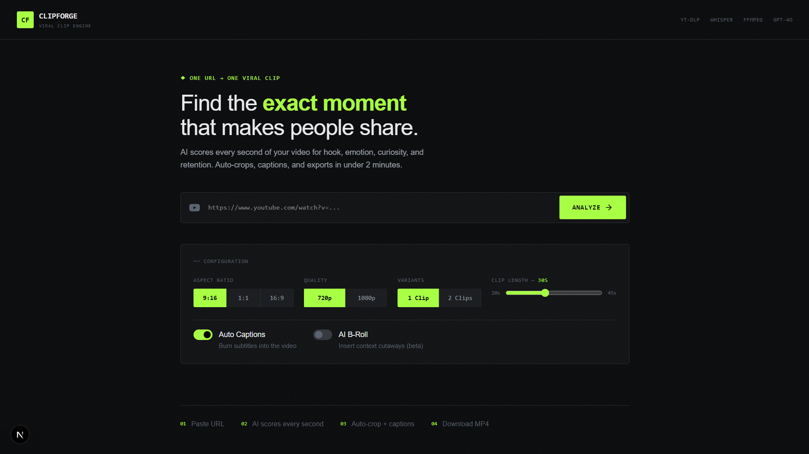

<div align="center">

```
 ██████╗██╗     ██╗██████╗ ███████╗ ██████╗ ██████╗  ██████╗ ███████╗
██╔════╝██║     ██║██╔══██╗██╔════╝██╔═══██╗██╔══██╗██╔════╝ ██╔════╝
██║     ██║     ██║██████╔╝█████╗  ██║   ██║██████╔╝██║  ███╗█████╗  
██║     ██║     ██║██╔═══╝ ██╔══╝  ██║   ██║██╔══██╗██║   ██║██╔══╝  
╚██████╗███████╗██║██║     ██║     ╚██████╔╝██║  ██║╚██████╔╝███████╗
 ╚═════╝╚══════╝╚═╝╚═╝     ╚═╝      ╚═════╝ ╚═╝  ╚═╝ ╚═════╝ ╚══════╝
```

### Paste a YouTube URL. Get a viral clip. In under 2 minutes.

[](https://nextjs.org)
[](https://typescriptlang.org)
[](https://ffmpeg.org)
[](LICENSE)



</div>

---

## ✦ What It Does

> AI watches your video. Finds the moment people can't stop sharing. Exports it in one click.

```
YouTube URL  →  Download  →  Transcribe  →  AI Score  →  Crop  →  Caption  →  MP4
```

| Step | Tool | What happens |
|------|------|-------------|
| 📥 Download | `yt-dlp` | Grabs video up to 1080p |
| 🎙️ Transcribe | `Whisper` (Groq) | Every word, timestamped |
| 🧠 AI Score | `Gemini / GPT-4o` | Scores clips on 6 viral dimensions |
| ✂️ Crop | `FFmpeg` | Auto-reframes to 9:16 / 1:1 / 16:9 |
| 💬 Caption | `FFmpeg drawtext` | Burns subtitles into the video |
| 📦 Export | `H.264 MP4` | 720p or 1080p, ready to post |

---

## 🧠 AI Scoring Logic

The model scores 3–5 candidate clips and picks the highest weighted score:

```
Hook        ████████████████████████████████  30%  → Grabs in first 2s
Emotion     ████████████████████████          20%  → Joy / Surprise / Awe
Curiosity   ████████████████████████          20%  → Makes you share
Retention   ██████████████████                15%  → Watched till the end
Humor       ████████████                      10%  → Genuine laughs
Story Payoff ██████                            5%  → Arc / Reveal / Punchline
```

---

## ⚡ Quick Start

### Prerequisites

```bash
node -v        # needs 20+
ffmpeg -version
yt-dlp --version
```

> **Windows?** Install ffmpeg from [ffmpeg.org](https://ffmpeg.org) and add it to PATH.

### Run Locally

```bash
git clone https://github.com/yourusername/clipforge
cd clipforge
npm install
cp .env.example .env
npm run dev
```

Open → **http://localhost:3000**

### Docker (one command)

```bash
cp .env.example .env   # add your keys
docker compose up
```

---

## 🔑 Environment Setup

```dotenv
# Clip Scoring — OpenRouter (free)
OPENROUTER_API_KEY=sk-or-v1-...
AI_MODEL=google/gemini-2.0-flash-exp:free
AI_BASE_URL=https://openrouter.ai/api/v1

# Transcription — Groq Whisper (free)
GROQ_API_KEY=gsk_...

# Storage
OUTPUT_DIR=./public/outputs
TEMP_DIR=./tmp
INLINE_WORKER=true
```

| Key | Where to get | Cost |
|-----|-------------|------|
| `OPENROUTER_API_KEY` | [openrouter.ai/keys](https://openrouter.ai/keys) | Free tier |
| `GROQ_API_KEY` | [console.groq.com](https://console.groq.com) | Free tier |

---

## 🎛️ Features

```
✅ Auto aspect ratio crop     9:16 · 1:1 · 16:9
✅ Burned-in captions         Whisper-accurate timestamps
✅ Quality selection          720p · 1080p
✅ Clip length control        20s – 45s slider
✅ Multi-candidate scoring    See all AI-ranked options
✅ Docker support             One command setup
✅ No login required          100% local
```

---

## 📁 Project Structure

```
clipforge/
├── app/
│   ├── page.tsx                 ← Single-page UI
│   └── api/
│       ├── jobs/route.ts        ← POST: start job
│       └── jobs/[id]/route.ts   ← GET: poll status
├── lib/
│   ├── pipeline.ts              ← Main orchestrator
│   ├── ai/analyzer.ts           ← Gemini clip scoring
│   └── video/
│       ├── downloader.ts        ← yt-dlp wrapper
│       ├── transcriber.ts       ← Whisper (Groq) wrapper
│       └── processor.ts         ← FFmpeg crop + captions
├── types/index.ts               ← Shared TypeScript types
├── Dockerfile
└── docker-compose.yml
```

---

## 🔧 Customisation

<details>
<summary><b>Change caption style</b></summary>

In `lib/video/processor.ts` → `buildCaptionFilter()`:
```ts
// TikTok-style yellow bold
fontcolor=yellow:bordercolor=black@0.9:borderw=4:fontsize=56

// Custom font
fontfile=/app/public/fonts/Montserrat-Bold.ttf
```
</details>

<details>
<summary><b>Add 2K quality</b></summary>

In `types/index.ts`:
```ts
export type Quality = '720p' | '1080p' | '2k'
```
In `lib/video/processor.ts`:
```ts
const height = quality === '2k' ? 1440 : quality === '1080p' ? 1080 : 720
'-crf', quality === '2k' ? '14' : '18'
```
</details>

<details>
<summary><b>Add channel intro / outro</b></summary>

Drop files into `public/branding/intro.mp4` and `outro.mp4`, then stitch with FFmpeg concat after render:
```ts
await stitchBranding({ mainClip, introPath, outroPath, outputPath })
```
See full guide in [BRANDING.md](./docs/BRANDING.md).
</details>

<details>
<summary><b>Change scoring weights</b></summary>

In `lib/ai/analyzer.ts`:
```ts
const weights = {
  hook: 0.5,       // ← boost hook priority
  emotion: 0.2,
  curiosity: 0.15,
  retention: 0.1,
  humor: 0.05,
  storyPayoff: 0,
}
```
</details>

---

## 🛠️ Tech Stack

| Layer | Tech |
|-------|------|
| Framework | Next.js 15 (App Router) |
| Language | TypeScript |
| Styling | Tailwind CSS + CSS Variables |
| AI Scoring | OpenRouter → Gemini 2.0 Flash |
| Transcription | Groq → Whisper Large v3 Turbo |
| Video | FFmpeg + yt-dlp |
| Queue | In-memory (BullMQ + Redis optional) |
| Deploy | Docker / Vercel / Railway |

---

## 📄 License

MIT — build whatever you want.

---

<div align="center">
  <sub>Built with Next.js · FFmpeg · Whisper · Gemini</sub>
</div>
